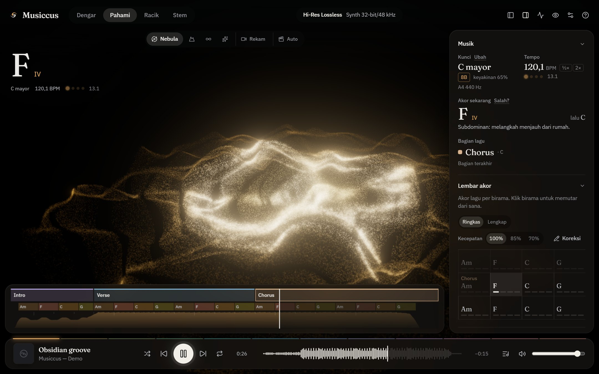
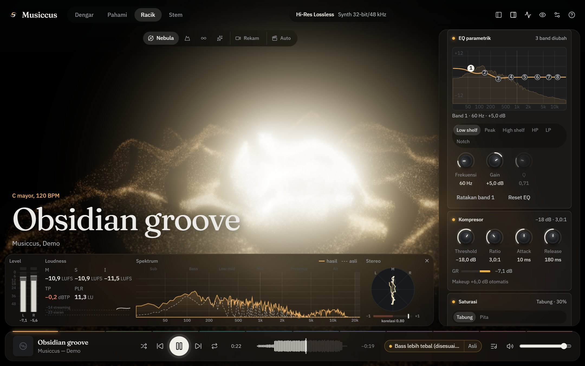
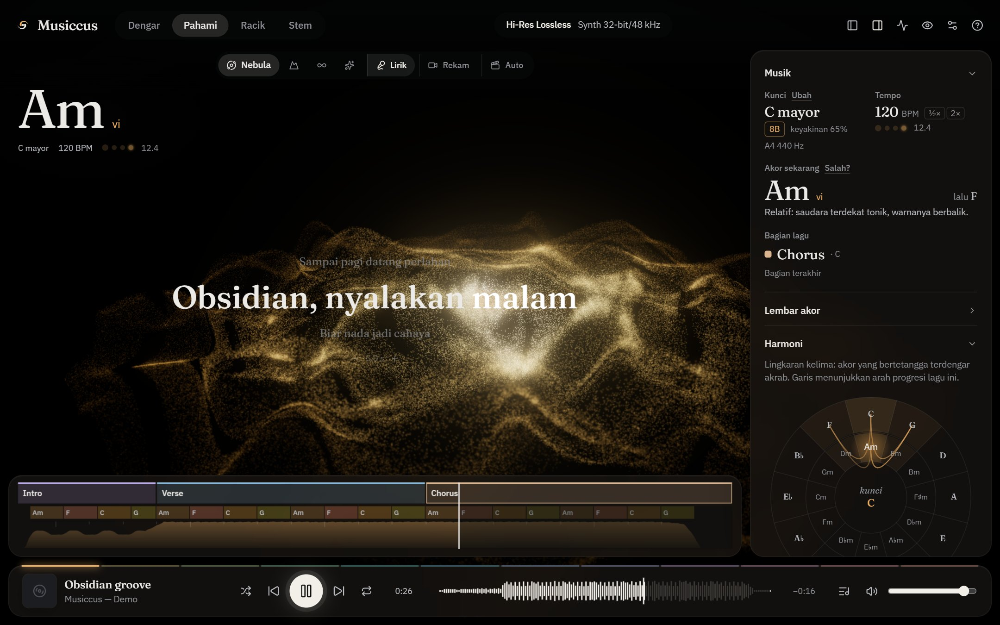
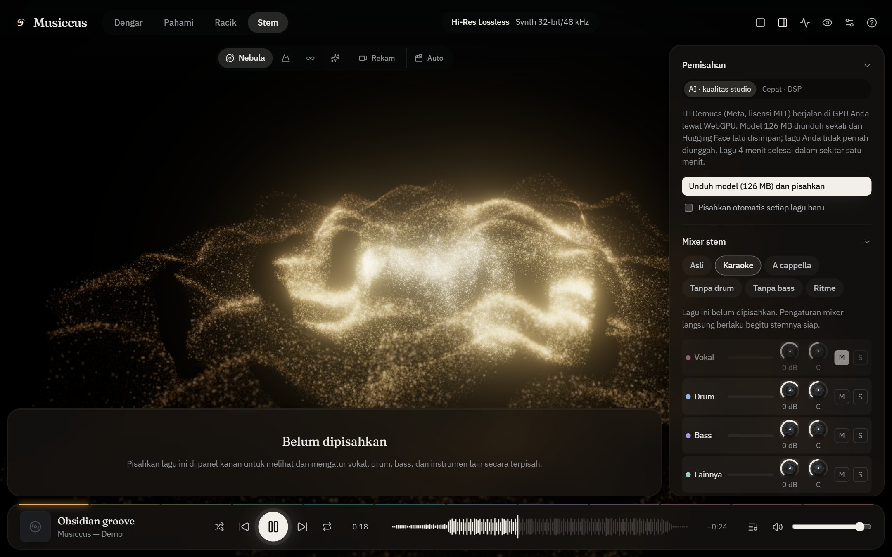

# Musiccus
Repo baru
**Pemutar musik yang bisa dilihat.**

Putar lagu, lalu lihat isinya: tempo, kunci, akor per ketukan, dan bagian lagu, dibaca langsung dari suaranya. 
Semuanya berjalan di browser; lagu Anda tidak pernah diunggah.

[Sorotan](#sorotan) · [Tur singkat](#tur-singkat) · [Diuji pada lagu terkenal](#diuji-pada-lagu-yang-anda-kenal) · [Fitur](#fitur) · [Cara kerja](#cara-kerja) · [Dokumentasi](#dokumentasi)

Mode Pahami di tengah chorus: akor F dibaca sebagai IV di C mayor beserta fungsinya, lembar akor per birama, dan Song Map.

Musiccus dibuat untuk penikmat musik sehari-hari yang ingin mendengar lebih dalam tanpa harus paham istilah teknis. Putar lagu dari koleksi sendiri, atau dengarkan tab Spotify dan YouTube Music lewat Musiccus. Selama lagu berjalan, Musiccus ikut mendengarkannya, lalu menjelaskan apa yang terjadi dengan bahasa biasa.

## Sorotan

- **Dibaca dari suaranya, bukan dicari dari database.** Tidak ada pencarian judul lagu untuk akor. Nada acuan lagu dikenali dulu, jadi lagu yang disetel 432 Hz tetap terbaca benar.
- **Membongkar file palsu.** FLAC yang ternyata dibuat dari MP3 ketahuan, lengkap dengan perkiraan bitrate asalnya. Begitu juga "Hi-Res" hasil upsample dan 24-bit yang isinya 16-bit.
- **Belajar dari The Beatles dan Queen.** Pembaca akor dan kuncinya disetel pada 56 rekaman beranotasi, lalu diuji di album yang tidak ikut dipakai menyetel. Kira-kira tiga dari empat ketukan dapat akor yang benar.
- **Pemisahan stem AI tanpa server.** HTDemucs dari Meta berjalan di GPU Anda lewat WebGPU; lagu 4 menit selesai dalam sekitar satu menit.
- **Meter yang mengukur, bukan memperkirakan.** Loudness BS.1770-4 / EBU R128 dan true peak dengan oversampling 4x, dihitung di setiap sampel.
- **Lirik per kata**, meski sumbernya hanya bertanda waktu per baris: diperkirakan dari suku kata, beat grid, dan stem vokal.

## Tur singkat

### Racik: EQ, kompresor, dan meter lengkap

Mulai dari preset satu klik seperti *Bass lebih tebal*, lalu atur lebih jauh. Semua angka di sini diukur dari suara yang sedang keluar.

- **EQ parametrik 8 band**, digambar di atas spektrum lagu. Setiap band bisa low shelf, peak, high shelf, HP, LP, atau notch. Di sini band 1 menaikkan 60 Hz sebesar +5 dB.
- **Kompresor** dengan threshold, ratio, attack, release, dan meter gain reduction. Makeup gain dihitung otomatis, jadi hasilnya tidak terdengar "lebih bagus" hanya karena lebih keras.
- **Saturasi** gaya tabung atau pita, dan **ruang** untuk reverb.
- **Panel Pantau** (tombol O): level per kanal; loudness Momentary, Short-term, dan Integrated dalam LUFS dengan garis acuan −14 untuk streaming dan −23 untuk siaran; true peak; PLR, yaitu jarak antara puncak dan loudness; spektrum hasil dibanding aslinya; dan goniometer dengan korelasi fase.
- Tombol **Asli** di sebelah nama preset memutar lagu aslinya pada loudness yang sama, jadi yang Anda bandingkan warna suaranya, bukan volumenya.

### Pahami: lirik dan akor bersamaan

Lembar akor bisa dilipat supaya panggung lebih lega. Di awal chorus ini terlihat:

- **HUD akor** di kiri atas: akor yang sedang berbunyi (Am, vi di C mayor), kunci, tempo, dan posisi birama serta ketukan.
- **Lirik kinetik** di tengah: setiap kata muncul saat dinyanyikan, dan baris chorus dibuat lebih besar. File `.lrc`-nya hanya bertanda waktu per baris; waktu per kata diperkirakan Musiccus sendiri.
- **Panel Musik**: kunci beserta kode Camelot dan tingkat keyakinannya, nada acuan A4, akor berikutnya, dan fungsi akor dalam kalimat biasa.
- **Harmoni**: lingkaran kelima, dengan garis yang menunjukkan arah progresi lagu.
- **Song Map**: bagian lagu, lajur akor per ketukan, dan energi di bawahnya.

Lagu demo bawaan Musiccus instrumental. Liriknya contoh yang ditulis khusus untuk screenshot ini dan dimuat sebagai file `.lrc`.

### Stem: karaoke dengan AI

Lagu dipisahkan menjadi vokal, drum, bass, dan lainnya, lalu diatur sesuka Anda.

- **Dua mesin pemisah.** *AI · kualitas studio* memakai HTDemucs dari Meta di GPU Anda lewat WebGPU. Modelnya 126 MB, diunduh sekali lalu disimpan di browser. *Cepat · DSP* langsung jalan tanpa unduhan; hasilnya lebih kasar, tetapi cukup untuk karaoke cepat.
- **Preset mixer**: Asli, Karaoke, A cappella, Tanpa drum, Tanpa bass, dan Ritme. Karaoke mematikan vokal dan menyisakan drum, bass, dan lainnya.
- **Per stem**: level, pan, mute, dan solo. Setiap stem juga bisa ditempatkan di panggung 3D binaural di sekitar kepala.
- Hasil pemisahan AI disimpan, jadi lagu yang sama tidak perlu dipisahkan lagi. Stemnya juga bisa diunduh sebagai WAV 24-bit.

Diambil sebelum pemisahan dijalankan. Preset Karaoke sudah dipilih dan langsung berlaku begitu stemnya siap.

## Diuji pada lagu yang Anda kenal

Pembaca akor dan kunci Musiccus tidak hanya diuji pada lagu sintetis. Ia disetel dan diukur pada 56 rekaman komersial dengan anotasi akor dari [Isophonics](http://isophonics.net): 43 lagu The Beatles dari *Abbey Road*, *Revolver*, dan *Sgt. Pepper's Lonely Hearts Club Band*, serta 13 lagu Queen.

Supaya hasilnya jujur, setiap album disisihkan bergiliran. Setelannya dicari dari tiga album lain, lalu diuji pada album yang belum pernah "didengar" itu.

| Album yang disisihkan | Setelan lama | Setelan baru |
| --- | --- | --- |
| Abbey Road | 68,6% | **74,3%** |
| Revolver | 70,2% | **75,6%** |
| Sgt. Pepper's | 57,4% | **62,0%** |
| Queen | 55,5% | **63,0%** |

Akor mayor/minor yang tepat, skor gaya MIREX yang ditimbang durasi.

- Dengan setelan akhir, akar akor The Beatles tepat 75,1% dan kuncinya tepat di 30 dari 43 lagu. Untuk Queen, 65,7% dan 8 dari 13.
- Pergantian akor yang terbaca benar biasanya meleset kurang dari seperempat ketukan. Yang masih sulit adalah akornya sendiri: power chord tanpa terts, progresi yang memang ambigu, dan aransemen padat seperti Queen.
- Pada lagu sintetis yang jawabannya pasti, 99,8% akor mayor/minor benar dan semua kuncinya tepat.

Metode lengkap dan cara mengulanginya dengan album Anda sendiri ada di [docs/DEVELOPMENT.md](docs/DEVELOPMENT.md#akurasi-akor-dan-kunci).

## Fitur

| Mode | Yang dilakukan |
| --- | --- |
| **Dengar** | Visual 3D yang bereaksi pada kick, snare, dan hi-hat, lirik kinetik atau panel karaoke, gapless, antrean, timer tidur, dan *Lanjutkan* dari detik terakhir. |
| **Pahami** | Tempo, kunci, akor per ketukan dengan angka Romawi dan fungsinya, bagian lagu, lembar akor, Song Map, lingkaran kelima, dan *Karakter rekaman* (dinamika, loudness, stereo, warna suara) dalam kalimat biasa. Akor yang salah bisa dikoreksi dan diekspor ke `.lab`. |
| **Racik** | Preset satu klik seperti Bass lebih tebal dan Slowed + reverb, tempo dan nada terpisah, perbandingan dengan aslinya pada loudness yang sama, rack EQ 8 band dan kompresor, serta ekspor WAV. |
| **Stem** | Vokal, drum, bass, dan lainnya dipisahkan dengan AI, lalu diatur sendiri: Karaoke, A cappella, atau panggung 3D binaural. |
| **Dengar dari tab** | Visual dan analisis live untuk lagu yang diputar di Spotify, YouTube Music, atau situs lain. |
| **Headphone saya** | Koreksi warna suara untuk lebih dari 6.000 model headphone dari [AutoEQ](https://github.com/jaakkopasanen/AutoEq), plus crossfeed. |
| **Cek kualitas file** | Keaslian file dari spektrumnya, dan *Jalur suara* yang menunjukkan apa saja yang mengubah suara sebelum sampai ke telinga. |

Format yang bisa diputar: MP3, AAC, FLAC, WAV, AIFF, Opus, dan Vorbis. Penjelasan lengkap setiap fitur ada di [docs/FEATURES.md](docs/FEATURES.md).

## Cara kerja

1. **Decode di perangkat.** File dibuka di browser dan tidak dikirim ke mana pun.
2. **Analisis sekali, di Web Worker.** Seluruh lagu dianalisis di latar belakang tanpa mengganggu pemutaran, lalu hasilnya disimpan.
   - **Tempo dan beat:** onset dari perubahan spektrum, tempo dari autokorelasi, lalu beat tracking dengan dynamic programming.
   - **Kunci dan akor:** nada acuan dikenali dulu, setiap ketukan diurai jadi nada beserta harmoniknya (cara NNLS Chroma/Chordino) dengan bass dibaca terpisah, lalu HMM memilih urutan akor yang paling masuk akal.
   - **Bagian lagu:** setiap birama dibandingkan dengan semua birama lain. Yang mirip dikelompokkan dan diberi nama Intro, Verse, Chorus, Bridge, atau Outro.
   - **Mastering dan keaslian:** loudness, true peak, DR, lebar stereo, dan "langit-langit" frekuensi yang ditinggalkan encoder lossy.
3. **Mendengar live di AudioWorklet.** Selama lagu diputar, setiap sampel diperiksa. Kick, snare, dan hi-hat ditandai tepat di sampelnya, dan visual serta lirik ditunda sebesar latensi output, jadi semuanya jatuh saat suaranya sampai ke telinga.
4. **Semua membaca sumber yang sama.** Visual, HUD akor, lirik, dan panel memakai peta lagu dan ketukan live yang sama. Warnanya diambil dari kunci lagu: lingkaran kelima diletakkan di atas roda warna, jadi kunci yang bersaudara mendapat warna yang bertetangga.

## Privasi

- Lagu tidak pernah diunggah. Pengaturan, hasil analisis, lirik, stem, dan model AI tersimpan di browser Anda.
- Hanya tiga permintaan yang keluar, dan semuanya bisa dimatikan atau tidak terjadi kalau fiturnya tidak dipakai: pencarian lirik ke [LRCLIB](https://lrclib.net), profil headphone dari AutoEQ, dan model pemisahan AI (sekali unduh).
- Dengar dari tab hanya meneruskan suara tab selama dibagikan, seperti panggilan video. Tidak ada yang direkam.

## Browser

| Browser | Dukungan |
| --- | --- |
| Chrome, Edge (desktop) | Semua fitur |
| Brave, Opera (desktop) | Termasuk dengar dari tab |
| Firefox, Safari | Pemutaran, visual, lirik, analisis, dan Racik. Tanpa buka folder, dengar dari tab, dan pemisahan AI |
| Browser di ponsel | Tata letak laci untuk layar kecil; dengar dari tab tidak tersedia |

## Dokumentasi

| Dokumen | Isi |
| --- | --- |
| [Fitur](docs/FEATURES.md) | Penjelasan lengkap setiap mode, semua pintasan keyboard, dan keterbatasan |
| [Pengembangan](docs/DEVELOPMENT.md) | Cara menjalankan sendiri, teknologi, arsitektur, metode uji akurasi, dan roadmap |
| [Deploy](docs/DEPLOY.md) | Hosting statis, PWA dan offline, pratinjau link, file AI di hosting sendiri |

## Terima kasih

- [LRCLIB](https://lrclib.net) untuk database lirik terbuka
- [AutoEQ](https://github.com/jaakkopasanen/AutoEq) dan para pengukurnya (oratory1990, crinacle, Rtings, dan lainnya)
- [Demucs](https://github.com/facebookresearch/demucs) dari Meta (lisensi MIT)
- [Isophonics](http://isophonics.net) untuk anotasi akor yang dipakai menguji akurasi
- NNLS Chroma dan Chordino karya Matthias Mauch, inspirasi pembacaan akor
